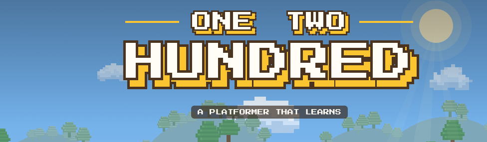
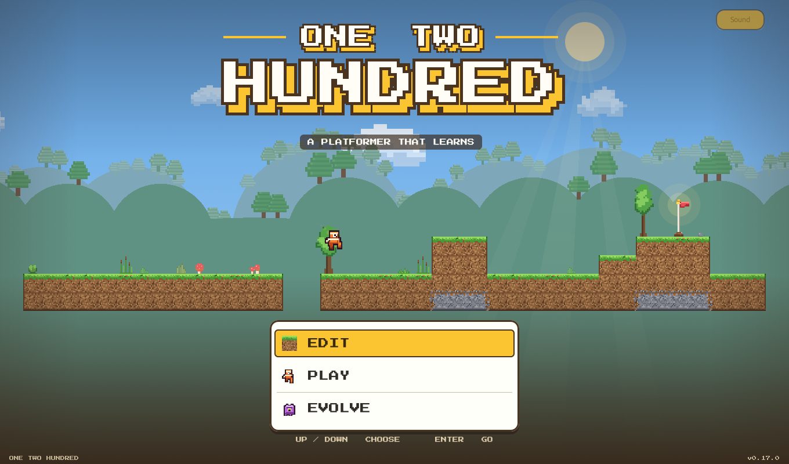
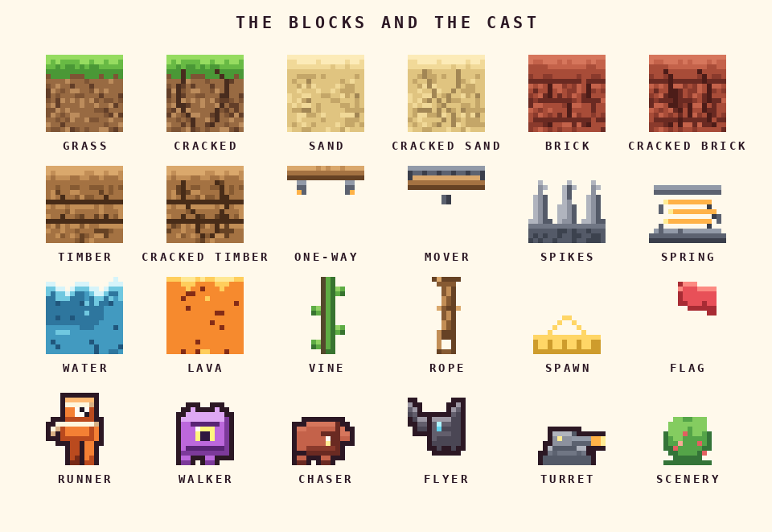
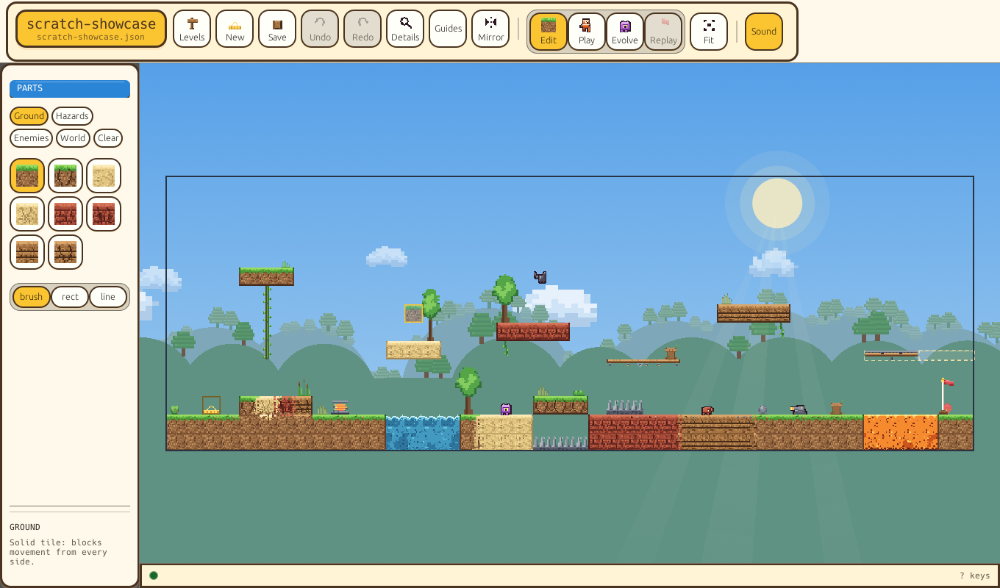
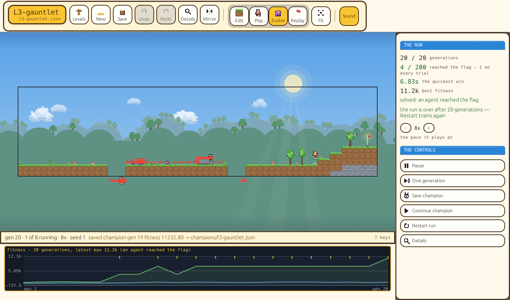
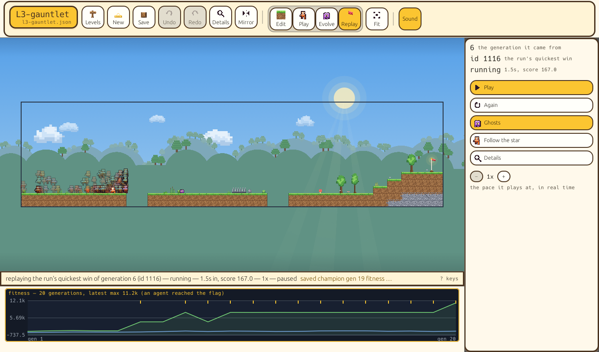

<p align="center">
  
</p>

<p align="center">
  <a href="https://github.com/nordicnode/evolution-platformer/actions/workflows/ci.yml"></a>
</p>

# One Two Hundred

A 2D platformer you build yourself, and an AI that learns to beat what you built.

Draw a level, play it yourself, then hand it to a population of 200 neural
networks and watch them evolve: the first generations stand still or walk into
pits, and a few hundred generations later one of them runs the level clean.
Everything happens in one window, and the training can also run headless from
the terminal.

## Screenshots



*The title screen: the demo run plays behind the wordmark.*



*The blocks and enemies a level is built from.*



*The editor, on `levels/scratch-showcase.json`, a level that uses every block
and enemy at once. The canvas is the game's own view; `G` adds the guides.*



*Evolve view: twenty generations into a run on L3, with the fitness chart
below.*



*Replay view: the run's quickest win, with the rest of its generation ghosted
beside it.*

## How it plays

**Edit.** Draw a level with the mouse: drag blocks, spikes, springs, enemies
and the flag out of the palette onto the canvas. The palette shows one shelf at
a time — ground, hazards, enemies, the level's own furniture, and the two
clearers — so it stays a handful of cells rather than a box of parts. A lamp on
the status line says whether the level can be beaten at all; `G` turns on the
guides — the tile grid, the reachability tint and the full verdict — when you
want to measure the level instead of look at it.

**Play.** Run the level yourself, against the clock. Once the AI has a best
time on the level, the playtest races you against it, and you can turn on a
ghost of the record-holding run to chase.

**Evolve.** Start a run and watch the population learn the level live: how
far the best agents get, how many have reached the flag, and the quickest
win so far. Save the best agent as a champion, carry it into the next run,
or open the replay to watch its winning run with the rest of its generation
ghosted beside it.

## Features

- **Level editor** with a shelved parts palette, a game-view canvas (the
guides are one key), undo/redo, eyedropper, line and
  rectangle tools, a browsable shelf of levels, and a mirror tool that flips
  the whole level in one step.
- **Four building materials** (grass, sand, brick, timber), all solid, plus
  one-way platforms and moving platforms with a visible travel guide.
- **Trap tiles:** cracked ground that crumbles shortly after something stands
  on it — the piece breaks off, falls, and shatters on the floor — and spring
  pads that throw whatever lands on them.
- **Elements:** water you swim in, lava that kills and throws fireballs, and
  vines you climb.
- **Ropes:** a line hanging from a ceiling that an airborne body catches with
  its hands and swings on. The arc is real physics — a pendulum with inertia,
  pumped by leaning and spent on release — so a rope turns a jump into a swing
  and a swing into a launch the running jump cannot match.
- **A physics engine of its own** (`crates/dynamics`): point masses, rigid
  links, ropes, gravity and tile collision, stepped one deterministic tick at a
  time. The rope you see is a world in it — a pinned tie, a chain of links and a
  grip at your hands — and the same crate is what the next falling crate, plank
  or boulder will be built from.
- **Enemies:** patrolling walkers, chasers that hunt you and stop at ledges,
  flyers on a set flight path, and turrets that shoot along their row.
- **A reachability check on every level**, so the editor can say "beatable"
  or point at the jump that cannot be made.
- **Evolution you can watch:** a live fitness chart, champions you can save,
  continue from and race against, and replays with ghost populations.
- **Learning you can read, not just a score:** every run reports how many agents
  solved, the best and median clock, the route leg and frame where the best
  genome ended, a per-leg census of the whole population, and how spread out
  its first decisions were. The window shows it in the Details panel, `train`
  prints it per generation, and `--telemetry <PATH>` writes one JSON object per
  generation for a later gate to read.
- **Runs that get unstuck:** if a population stalls, the run can fall back to
  an easier version of the level, learn there, and carry what it learned back.
  Once a level is solved, a mastery mode keeps evolving for a faster time
  instead of stopping.
- **A planner, as well as a learner:** the deliberate controller (`T` in the
  playtest) works out a route through the level with the game's own physics
  and plays it, which answers levels whose trick is timing or waiting. That
  route can be compiled into a **route plan** — certified, cut into the same
  legs the training telemetry counts, with each leg's timing margin — and a
  fresh run starts a quarter of its first population from a clone of it.
- **Headless training** with `train-cli`: train, watch, replay champions,
  check levels, and run seed benchmarks, all from the terminal. A run started
  in the window can be resumed in the terminal and the other way round.
- **Synthesised sound**, with no audio assets: an effect for every jump,
  stomp, spring and death; water and lava beds that fade in as you approach
  them, with splashes and swim strokes, and lava vents that announce a volley;
  an original minute-and-a-quarter theme that runs through intro, four
  sections, a bridge and a final chorus before it loops; and a sound switch on
  every screen.

## The levels

Twelve levels ship with the game, each teaching one thing:

| Level | What it teaches |
|---|---|
| `l1-flat-run` | Nothing. A flat run to the flag |
| `l2-first-gap` | The first pit, and jumping on purpose |
| `l3-gauntlet` | Pits and spikes in sequence |
| `l4-rhythm` | A jump that has to be timed |
| `l5-tightrope` | Narrow ground and landing precision |
| `l6-marathon` | A long level, start to finish |
| `l7-ascent` | Wall jumps, as the way up |
| `l7-wall-school` | Wall jumps with nothing else going on |
| `l8-long-jump` | Sprinting, and the gap only a sprint jump clears |
| `l9-wait-and-climb` | A chain of everything, including waiting for a patrol |
| `l10-the-hunt` | Enemies: flyers, a chaser, a turret, a moving platform |
| `l11-the-elements` | Water, lava and vines |

There is also a set of small adversarial levels (`levels/bat-*.json`), one per
skill the AI is meant to have, and working levels named `levels/scratch-*.json`,
including the showcase level in the screenshot above and `levels/scratch-rope.json`,
a pit crossed only by swinging. The editor's palette has a rope brush that paints a
**cell** at a time, like every other part of a level: a click hangs one cell of line
from the ceiling above it, and dragging down grows that line a cell per row (a cell
inside a line is refused, because it is already rope).

`levels/practice/` is a **generated, certified practice suite**: twenty-four
levels, six mechanics at four tiers, every one checked by the reachability
oracle *and* the timed planner before it is written. `train-cli fuzz` prints that
certification table, and `train-cli fuzz --out levels/practice` regenerates the
suite byte for byte from its own seed.

`train-cli routeplan` compiles a level's certified route into plan legs with
per-leg margins (`--all --levels-dir levels/practice --out plans` for the whole
suite). A level the oracle certifies but the planner cannot route is reported
as such; the window then starts that run's population random rather than warm.

`train-cli train --from-plan` goes further: its DAgger corrections are planned
from the state the clone actually reaches (one route crossing at a time), and a
leg curriculum takes the first leg the clone fails and spends the rest of the
fit budget on it. The `clone` line ends with the per-leg mastery reading — how
many legs were cleared, and which one stopped it.

## Quick start

You need a Rust toolchain. From the top of the repo:

```bash
cargo build --release

# The game: title screen, then the editor on the first level
cargo run --release -p app

# Open a level straight into a run, a playtest, or a replay
cargo run --release -p app -- --evolve --level levels/l2-first-gap.json
cargo run --release -p app -- --play --level levels/l2-first-gap.json
cargo run --release -p app -- --replay --generations 20 --level levels/l3-gauntlet.json

# Headless: train a level, check whether a level can be beaten at all
./target/release/train-cli train --level levels/l3-gauntlet.json --generations 200 --pop 200 --stop-on-win
./target/release/train-cli train --level levels/practice/p17-mover-t2.json --telemetry out/p17.jsonl
./target/release/train-cli reach --level levels/l11-the-elements.json
./target/release/train-cli routeplan --level levels/practice/p17-mover-t2.json
./target/release/train-cli fuzz --out levels/practice

cargo test --workspace   # the test suite
```

`train-cli --help` lists everything the terminal can do.

## Controls

**Title screen:** up/down and Enter choose, `P` goes straight to the
playtest, `E` straight to a run.

**Edit:** click paints, drag a palette item to place it, right-drag erases,
wheel zooms, middle-drag (or alt-drag) pans, ctrl+click picks the tile under
the pointer as your brush, shift-drag draws a line. `Ctrl+S` saves, `Ctrl+Z`
and `Ctrl+Y` undo and redo, `G` toggles the guides (grid, reachability tint,
verdict), `F` fits the level, `P` plays.

**Play:** arrows or WASD move and jump, `R` restarts, `G` toggles the
record-holder ghost, `T` hands control to the planner, `P` or Esc goes back
to the editor.

**Evolve:** space pauses, `N` steps one generation, `-` and `+` change the
speed, `S` saves the champion, `C` continues from a saved champion, `V`
opens the replay, `F` toggles following the leader.

Press `?` in any view for the full key card for that view.

## More detail

This page is the short version, on purpose. The measurements, the numbered
findings and the version history of the physics, sensors and scoring are in
[FINDINGS.md](FINDINGS.md), and the forward plan for the AI is in
[AI_IMPROVEMENT_PLAN.md](AI_IMPROVEMENT_PLAN.md).

The game is in active development (currently sim 0.17.0, level format v3).
Champion files record the exact physics and scoring they were trained under
and are refused, rather than mis-replayed, if the game has moved on since.
